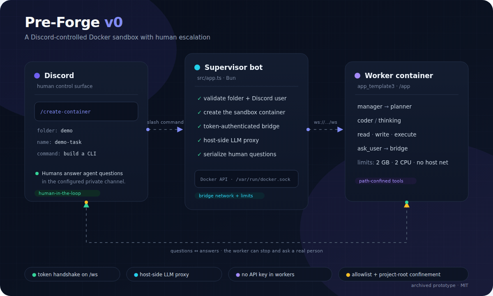
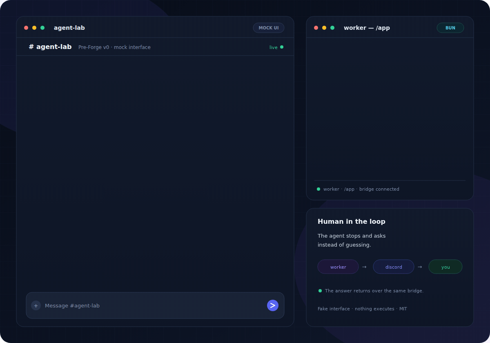

# Pre-Forge (v0)

**The first version of what became TheForge.**

This is the original prototype: a Discord-controlled Docker sandbox that runs a coding agent inside a container and escalates to a human over Discord when the agent gets stuck. It is kept as the starting point of the TheForge lineage, not as a finished product.

The idea came from [`edouwarden/Discord-self-augmented-Bot`](https://github.com/edouwarden/Discord-self-augmented-Bot), but this is not a fork of it. That bot was first used in a private Discord server with friends: one command replaced a specific user's message with a webhook that kept the same avatar and display name, but posted binary content instead of the original text. The part that mattered was that the behaviour could change on the fly: anyone in the server could do it, without writing or deploying code. Pre-Forge took that "change the bot while it is running" idea and pointed it at a sandboxed coding agent.

As of November 2026 the upstream repository is no longer publicly reachable, so it could not be inspected. The code here is an independent implementation of the idea, not a copy of that bot.

The newer TheForge implementation is not in this folder. This repository documents where the idea started.



---

## What it does

```text
Discord
  │  /create-container <folder> <name> <command> [attachments]
  ▼
Supervisor bot (src/app.ts)
  │  validates the folder and container name
  │  creates a Docker container
  │  mounts ./projects/<folder> → /app
  │  serves an authenticated WebSocket bridge on :3000/ws
  │  serves an authenticated LLM proxy on :3000/llm/chat/completions
  ▼
Worker container (app_template3/)
  │  manager → planner → coder / thinking
  │  tools: read, write, execute, ask_user
  │
  ├─ normal progress ──► info/debug messages back to Discord
  └─ blocked ──────────► question over WebSocket
                          supervisor posts it in Discord
                          human answers
                          worker continues
```

The important loop is **human-in-the-loop escalation**: the agent is allowed to stop and ask a real person instead of hallucinating a solution.

## Demo



The animation is a scripted mock-up: a command is typed, the container starts, the plan is confirmed, the worker asks which package manager to use, and the human answers. The terminal on the right shows the matching bridge and agent output. Nothing executes.

For an interactive version with a fake Discord input box and a live terminal log, open [`demo/index.html`](demo/index.html) directly in a browser. It is self-contained: no build step, no dependencies, and no network calls. You can type a command, answer the agent, or replay the scripted run.

> GitHub shows the SVGs above but serves HTML files as source. Open `demo/index.html` locally to use the interactive mock.

## What is in the folder

| Path | Role |
|---|---|
| `src/app.ts` | Supervisor: Discord bot, `/create-container`, Docker API, authenticated WebSocket bridge, LLM proxy, question relay |
| `src/deploy-commands.ts` | Registers the slash command |
| `src/prompt_optimizer.ts` | Early experiment in improving prompts from expected/actual outputs |
| `app_template3/manager.ts` | Worker entry point: plan, confirm, dispatch tasks |
| `app_template3/agents/` | `planner`, `coder`, `thinking`, agent registry |
| `app_template3/tools/` | Read file, write file, execute command, ask user, LLM client, path guard |
| `app_template3/wsClient.ts` | Worker-side WebSocket client with typed `ask()` and token handshake |
| `app_template3/Dockerfile` | Worker image; code in `/init`, workspace in `/app` |
| `assets/` | Animated SVG sources and GIF exports for the README |
| `demo/` | Self-contained interactive mock of the Discord bridge |

## Why it is “pre-Forge”

TheForge’s design document describes a much larger machine: TREEFRAG code representation, context compression, cost and time budgets, a state file for crash recovery, security checks, a refactor loop, a shadow workspace, and a merge queue.

This prototype has the seed of that system:

| Pre-Forge (this folder) | TheForge (later design) |
|---|---|
| One container per command | Isolated workspace per task |
| Planner → coder → ask human | Planner → coder → security → test → refactor → merge |
| Plain prompt context | TREEFRAG / stingy context |
| Human answers over Discord | Human escalation plus formal state file and approval gates |
| No cost accounting | Per-step and per-HQ cost limits |
| No merge isolation | Shadow sync and merge queue |

That is the evolution story: **from “spawn a sandbox and ask a human” to “an orchestrated pipeline with explicit context, cost, and merge control.”**

## Status

Archived prototype, kept as a POC. It is runnable enough to demonstrate the full loop, but expect rough edges:

- Free OpenRouter model IDs rotate. Override `LLM_MODEL`, `PLANNER_MODEL`, and `CODER_MODEL` when the defaults stop working.
- The worker does not reconnect if the WebSocket bridge drops. The task fails instead.
- Questions are serialized through one Discord channel, so concurrent tasks wait for each other.
- The planner and coder rely on small free models following a JSON tool protocol, which they do not always do well.
- There are no automated tests, no rate limiting, no cost accounting, and no state recovery.

It is **not production-ready**.

## Security limits

Read these before running it anywhere:

- **The Docker socket is root-equivalent on the host.** The supervisor mounts `/var/run/docker.sock`. Anyone who can control the bot process can control Docker, and therefore the host. Run it on a dedicated machine or VM, never on a personal workstation.
- **The bridge listens on all interfaces by default.** Worker containers reach the host through `host.docker.internal`, so `WS_HOST=0.0.0.0` is the practical default. Set `WS_HOST` to the Docker bridge gateway (for example `172.17.0.1`) and firewall the port if the host has other network exposure.
- **The command allowlist is a guardrail, not a boundary.** It checks the first token and blocks shell metacharacters, but interpreters such as `bun`, `node`, `npx`, `git`, `sed`, and `awk` can still execute arbitrary code. The container is the real boundary.
- **Any human in `QUESTION_CHANNEL_ID` can answer questions.** There is no per-question authorization. Keep the channel private and do not invite untrusted users.
- **The LLM proxy trusts any holder of `BRIDGE_TOKEN`.** A compromised worker can spend the supervisor’s OpenRouter budget. Use a scoped key and a spending limit.
- **The workspace is writable.** The agent can modify or delete files in `projects/<folder>` because that folder is bind-mounted into the container.
- **There is no audit trail.** Containers use `AutoRemove`, and messages are sent to Discord rather than stored. Add logging before relying on it.
- **Prompt injection is inherent.** Discord messages, file contents, and model output are untrusted input to an agent that can run commands.
- **No rate limiting, cost accounting, state recovery, or test suite.** Those are TheForge features, not v0 features.

## Quick start

Prerequisites: Docker, Bun ≥ 1.2, a Discord application with a bot token, and an OpenRouter-compatible API key.

```bash
cd agent

# 1. Install supervisor dependencies
bun install

# 2. Configure the environment
cp .env.example .env
# edit .env: DISCORD_TOKEN, CLIENT_ID, QUESTION_CHANNEL_ID,
#            AUTHORIZED_USER_IDS, BRIDGE_TOKEN, OPENROUTER_API_KEY
# optional: override LLM_MODEL / PLANNER_MODEL / CODER_MODEL if the
#           default free models are unavailable

# 3. Build the worker image
docker build -t bun-typescript-app ./app_template3

# 4. Register the slash command
bun run deploy-commands

# 5. Start the supervisor
bun run start
```

Create a workspace and run a task:

```bash
mkdir -p projects/demo
```

Then, in Discord:

```text
/create-container folder:demo name:demo-task command:"Build a small TypeScript CLI that prints the current time."
```

The supervisor validates `demo`, mounts `./projects/demo` at `/app`, starts the worker, and relays progress and questions to `QUESTION_CHANNEL_ID`.

### How the bridge is wired

The supervisor injects these values into each worker container:

| Variable | Default | Purpose |
|---|---|---|
| `BRIDGE_TOKEN` | required | Shared secret for WebSocket and LLM proxy auth |
| `WS_URL` | `ws://host.docker.internal:3000/ws` | Worker bridge endpoint |
| `LLM_ENDPOINT` | `http://host.docker.internal:3000/llm/chat/completions` | Host-side LLM proxy |
| `PROJECT_DIR` | `/app` | Workspace root for the file and command tools |
| `ALLOWED_COMMANDS` | built-in list | Optional command allowlist; `*` disables it |
| `LLM_MODEL` | `cohere/north-mini-code:free` | Default model for helper calls such as file summaries |
| `PLANNER_MODEL` | `google/gemma-4-31b-it:free` | Model used by the planner |
| `CODER_MODEL` | `cohere/north-mini-code:free` | Model used by the coder |
| `MAX_RETRIES` | `3` | LLM request attempts (1–5) |

The worker sends an `auth` message as its first WebSocket frame. The supervisor accepts only a constant-time token match and then relays `info`/`error`/`warn`/`debug` messages and `question`/`answer` exchanges.

## Validation

```bash
bun run typecheck           # supervisor
bun run typecheck:worker    # worker template

bun build ./src/app.ts --target=bun --outdir=/tmp/agent-build
bun build ./src/prompt_optimizer.ts --target=bun --outdir=/tmp/agent-build
bun build ./app_template3/manager.ts --target=bun --outdir=/tmp/agent-build
```

Both typechecks pass, and the worker image builds with `docker build`.

## Repository notes

- No `.env`, bot token, OpenRouter key, or personal project data is included.
- `node_modules/`, `.env*`, `projects/`, `dist/`, and logs are ignored.
- The upstream `Discord-self-augmented-Bot` repository returns 404, so it could not be inspected.
- The `projects/` directory is kept only as an empty mount point; workspaces are not committed.
- The illustrations ship as both animated SVGs and GIF exports; the interactive demo is a single self-contained HTML file. There are no external assets or trackers.

## License

MIT. See [`LICENSE`](LICENSE).

## Stack

- Bun / TypeScript
- `discord.js` v14
- `dockerode`
- `zod`
- WebSocket (Bun server + browser-style client)
- OpenRouter-compatible LLM API

## Related

- Current implementation: [`../theforge/version3/`](../theforge/version3/) and [github.com/edouwarden/theforge](https://github.com/edouwarden/theforge).
- Original inspiration: [`edouwarden/Discord-self-augmented-Bot`](https://github.com/edouwarden/Discord-self-augmented-Bot) (no longer publicly reachable as of November 2026).
- Portfolio index: [`../PROJECTS.md`](../PROJECTS.md).
